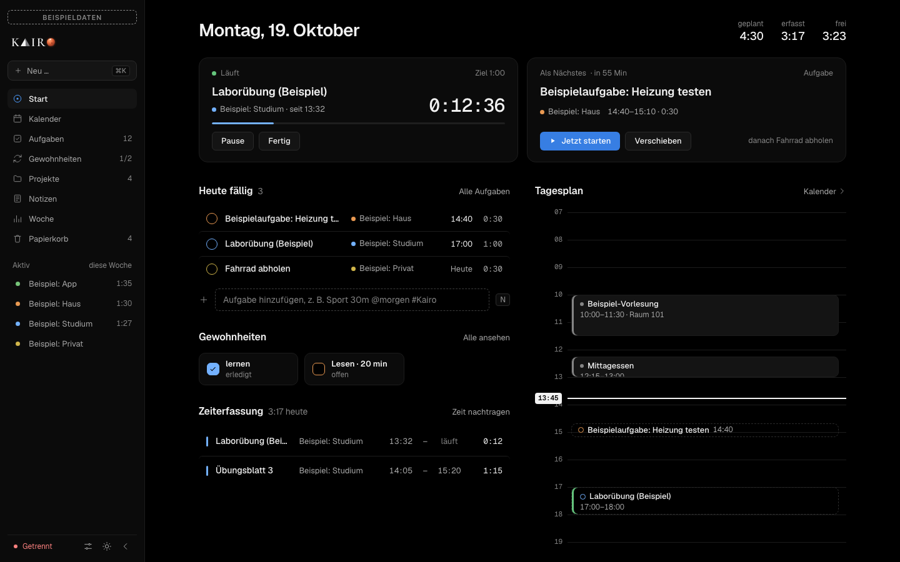
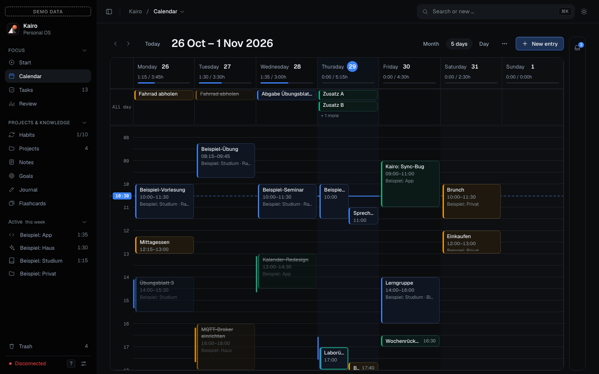
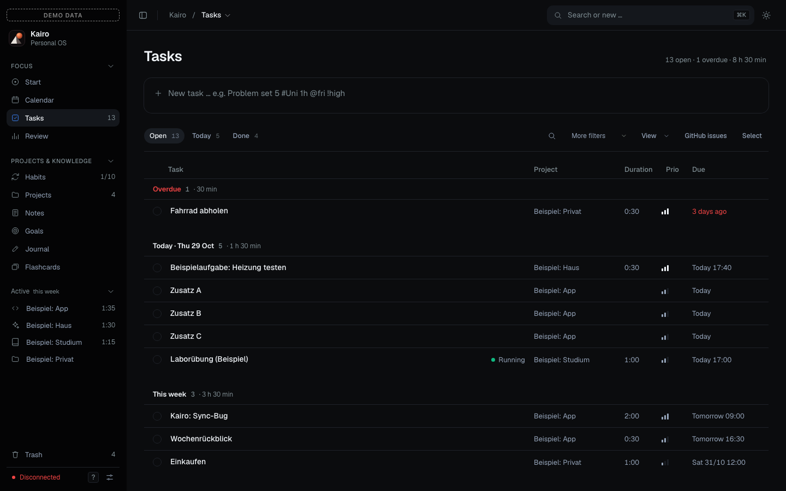
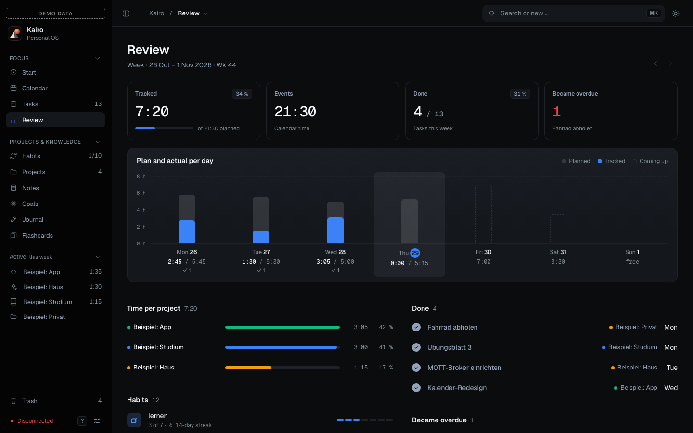

# Kairo

**Plan your day in the browser. Do the work in your editor. Kairo keeps both in sync.**

Kairo is a local-first planner for tasks, calendar events, habits, notes, goals, journaling, and flashcards. It runs on your own computer (macOS, Windows, Linux, or Raspberry Pi): no cloud, no subscription. Your data is one SQLite file you can copy anywhere.

[](https://go.dev)
[](LICENSE)
[](https://github.com/Mirac61/Kairo/actions/workflows/ci.yml)
[](#tests)


*Demo data, not a real account.*

By default Kairo only listens on `127.0.0.1` and needs no account. When you bind it to another address (for example on a Raspberry Pi with `KAIRO_HOST=<wg-ip>`, reachable only through WireGuard), login is enabled automatically and the first start asks you to create the one account at `/setup`. On your laptop it stays login-free.

## Table of Contents

- [Why Kairo](#why-kairo)
- [Prerequisites](#prerequisites)
- [Getting started](#getting-started)
- [Usage](#usage)
- [What's inside](#whats-inside)
- [Your data](#your-data)
- [Development](#development)
- [Tests](#tests)
- [Contributing](#contributing)
- [License](#license)

## Why Kairo

- **One place for your day.** Calendar, tasks, and habits sit side by side, so you see at a glance what's on and what's next.
- **Built for working in your editor.** The VSCodium/VS Code extension knows which project you have open and shows its tasks. Start a timer right there, or open the project workspace and its resources from the web UI.
- **Honest time tracking.** Timers only run when you start them. When you go idle, Kairo asks before it counts the time.
- **Notes are just files.** Markdown in a normal folder, so you can edit them in Kairo or in your editor. You can also annotate PDFs and images, and embed Excalidraw drawings.
- **Fast to type.** `Gym 30m @tomorrow #Uni !high` creates a 30-minute, high-priority task for tomorrow in project "Uni".
- **English or German.** Switch the language in the settings at any time. The whole interface, including keyboard help and error messages, follows the choice.

## Prerequisites

- To run a release: macOS, Windows, Linux, or a Raspberry Pi. No Go, Node.js, or database server is required.
- To build from source: Go 1.27 or newer, Node.js 22.18 or newer, pnpm, and GNU Make (or run the commands below manually).
- Optional: VSCodium or VS Code for the extension.

## Getting started

1. **Download** the file for your system from the [latest release](https://github.com/Mirac61/Kairo/releases):

   | System | File |
   |---|---|
   | macOS (Apple Silicon) | `kairo_…_darwin_arm64.tar.gz` |
   | macOS (Intel) | `kairo_…_darwin_amd64.tar.gz` |
   | Windows | `kairo_…_windows_amd64.zip` |
   | Linux | `kairo_…_linux_amd64.tar.gz` (or `arm64`) |

2. **Unpack it and start Kairo.**
   - **macOS / Linux:** in a terminal, run `tar xzf kairo_*.tar.gz` and then `./kairo`. If macOS blocks it, run `xattr -d com.apple.quarantine kairo` once.
   - **Windows:** unzip, then double-click `kairo.exe`. If SmartScreen warns you, click "More info" → "Run anyway".
3. **Open <http://127.0.0.1:8742>** in your browser. Kairo starts in your browser's language; you can change it under settings.

The binary serves the web UI itself. Nothing else needs to run.

Optional: install `kairo-*.vsix` from the same release in VSCodium or VS Code (Extensions → "Install from VSIX…"). The extension is optional, but it is where Kairo connects planning with actual work.

**Start Kairo automatically at login.** Put the program in a fixed place and run `kairo install` from there. Remove it with `kairo uninstall`.

| System  | How it starts                             | Log                              |
| ------- | ----------------------------------------- | -------------------------------- |
| macOS   | LaunchAgent                               | `~/Library/Logs/kairo.log`       |
| Linux   | systemd user service                      | `journalctl --user -u kairo`     |
| Windows | script in your Startup folder (no window) | `%LOCALAPPDATA%\kairo\kairo.log` |

## Usage

Open <http://127.0.0.1:8742>. The Start page answers four questions: what is happening today, what is due, which habits are still open, and what to work on now.

- Start a task with its play button. Kairo keeps at most one timer running.
- Add tasks with the quick-add field: `Gym 30m @tomorrow #Uni !high`. The same syntax works in the extension.
- Press `?` for the keyboard shortcut overview and `Cmd/Ctrl+K` for search across the app.
- Click **In VSCodium** on a task or project to open its workspace and resources. The timer is started explicitly, never just because a workspace was opened.
- Under **Settings**, change the language, theme, notes folder, work hours, week start, and backups.

## What's inside


*Calendar: events and planned tasks in one week, next to the time you tracked.*

| View | What it does |
| --- | --- |
| **Start** | Running timer, what's next, today's plan with drag and drop |
| **Calendar** | Events and planned tasks in one week, next to the time you tracked. Imports `.ics` files |
| **Tasks** | Quick-add syntax, keyboard shortcuts, subtasks, priorities |
| **Habits** | Daily or weekly habits with a 28-day grid |
| **Projects** | Colors, links and files, time per project |
| **Notes** | Markdown, PDFs, images and code. Draw on PDFs, sketch with Excalidraw drawings embedded in notes, split view, templates |
| **Goals** | Long-term goals with milestones and progress |
| **Journal** | A daily page for reviewing the day and planning tomorrow |
| **Flashcards** | Anki-style spaced repetition |
| **Review** | A short review of your week |
| **Trash** | Everything you delete can be restored |

Almost every action can be undone right away.


*Tasks: quick add, filters, priorities, estimates, and the running timer.*


*Review: planned versus tracked time, completed tasks, and habits.*

## Your data

- Everything stays on your machine. By default Kairo only listens on `127.0.0.1`.
- Database: `~/.local/share/kairo/kairo.db` (on Windows inside your user folder). Kairo backs up automatically before migrations and at most once a day; `kairo backup` makes one on demand.
- Notes: `~/Kairo` by default. Markdown, PDFs, and images are normal files; you can change the folder in the app under settings.

---

## Development

Kairo is a Go backend with a Vue frontend and a TypeScript extension. The commands below cover the backend and web UI; the extension has its own build step (`pnpm compile` in `extension/`, see [`extension/README.md`](extension/README.md)).

### Build from source

You need Go (version from `backend/go.mod`), Node.js 22.18+, and pnpm.

```sh
make install   # install dependencies
make build     # build web UI + backend
./backend/bin/kairo
```

### Run locally

```sh
cd backend  && go run ./cmd/server   # API on :8742
cd frontend && pnpm dev              # UI on :5173 with hot reload
```

The Vite dev server proxies `/api` and `/ws` to `127.0.0.1:8742`.

### How it fits together

```text
Web UI (Vue 3)  ─┐
Extension       ─┼─ HTTP + WebSocket ─ Backend (Go) ─ SQLite
Menu bar plugin ─┘
```

The Go backend is the only place that stores product data. Notes stay normal Markdown, PDF, and image files. The web UI is built into the binary.

| Path | Responsibility |
| --- | --- |
| `backend/` | Go API, SQLite, service and repository layers |
| `frontend/` | Vue 3 + TypeScript + Vite UI |
| `extension/` | VSCodium/VS Code extension |
| `tools/menubar/` | SwiftBar plugin for the menu bar |
| `docs/` | Vision, architecture, roadmap, and deployment notes |

More detail:

- [`backend/README.md`](backend/README.md): configuration and environment variables
- [`frontend/README.md`](frontend/README.md) and [`extension/README.md`](extension/README.md)
- [`docs/`](docs/): vision, architecture, and roadmap (in German)
- [`docs/PI_DEPLOYMENT.md`](docs/PI_DEPLOYMENT.md): how to run Kairo on a Raspberry Pi behind WireGuard (`./deploy.sh`)
- Releases are built from tags with `.goreleaser.yaml`

## Tests

```sh
make check   # gofmt, vet, Go tests, type-check, lint, frontend unit tests, extension build
make e2e     # Playwright smoke tests against a throwaway backend
```

`make check` is the same gate CI runs. `make e2e` builds the real binary first and then exercises the main user flows in a browser. The backend tests use temporary databases; they never touch your real data.

## Contributing

Kairo is primarily a personal project, but bug reports and pull requests are welcome. Run `make check` before opening a pull request; for larger changes, open an issue first so we can agree on the approach.

## License

Kairo is released under the [MIT License](LICENSE). Licenses of bundled third-party software (Excalidraw, React, fonts) are in [`THIRD_PARTY_NOTICES.md`](THIRD_PARTY_NOTICES.md).
